# M0 Identity & Access — Design

> Design-time contract for M0 Identity & Access, merged from the former 26-file module-0 bundle. Where it differs from code, the code and `docs/SYSTEM_REFERENCE.md` (generated) win; known differences and target-architecture gaps are tracked in `plan.md`.

## System architecture

### Component Overview

M0 Identity is a self-contained identity platform composed of the following layers and components:

```
┌─────────────────────────────────────────────────────────────────────┐
│                          API Gateway (Kong)                         │
│                     TLS Termination + Routing                       │
└────────────────────────────────┬────────────────────────────────────┘
                                 │
                                 ▼
┌─────────────────────────────────────────────────────────────────────┐
│                        Go Application (Gin)                         │
│                                                                     │
│  ┌───────────────────────────────────────────────────────────────┐  │
│  │                     Middleware Stack                           │  │
│  │  CORS → RateLimit → TenantResolver → Auth → RBAC → Audit    │  │
│  └──────────────────────────┬────────────────────────────────────┘  │
│                              │                                      │
│  ┌──────────────────────────▼────────────────────────────────────┐  │
│  │                       Controllers                              │  │
│  │  TenantController │ AuthController │ UserController            │  │
│  │  RoleController   │ PermissionController                      │  │
│  └──────────────────────────┬────────────────────────────────────┘  │
│                              │                                      │
│  ┌──────────────────────────▼────────────────────────────────────┐  │
│  │                        Services                                │  │
│  │  TenantService │ AuthService │ UserService                     │  │
│  │  RoleService   │ PermissionService │ SessionService            │  │
│  │  AuditService  │ TokenService                                  │  │
│  └──────────────────────────┬────────────────────────────────────┘  │
│                              │                                      │
│  ┌──────────────────────────▼────────────────────────────────────┐  │
│  │                      Repositories                              │  │
│  │  TenantRepo │ UserRepo │ RoleRepo │ PermissionRepo             │  │
│  │  SessionRepo │ RefreshTokenRepo │ PasswordResetTokenRepo       │  │
│  │  MFAConfigRepo │ AuditLogRepo │ TenantSettingsRepo             │  │
│  └──────────────┬──────────────────────┬────────────────┬────────┘  │
│                  │                      │                │           │
│                  ▼                      ▼                ▼           │
│           ┌────────────┐       ┌──────────────┐  ┌────────────┐     │
│           │ PostgreSQL │       │    Redis      │  │  RabbitMQ  │     │
│           └────────────┘       └──────────────┘  └────────────┘     │
└─────────────────────────────────────────────────────────────────────┘
```

---

### Component Diagram

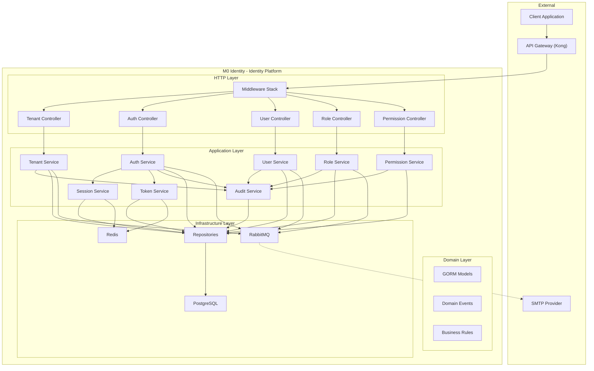

---

### Internal Engine Diagram

#### Middleware Pipeline

Every HTTP request passes through the middleware stack in order:

```mermaid
graph LR
    A["Incoming Request"] --> B["CORS Middleware"]
    B --> C["Rate Limiter"]
    C --> D["Request Logger"]
    D --> E["Tenant Resolver"]
    E --> F["JWT Auth"]
    F --> G["User Status Check"]
    G --> H["RBAC Permission Check"]
    H --> I["Audit Logger"]
    I --> J["Controller Handler"]
```

| Middleware | Responsibility | Skipped For |
|-----------|---------------|-------------|
| **CORS** | Set CORS headers | Never |
| **Rate Limiter** | Enforce request rate limits per IP and per user | Never |
| **Request Logger** | Log request method, path, duration, status code | Never |
| **Tenant Resolver** | Extract subdomain → resolve tenant → inject `tenant_id` into context | Tenant management endpoints (Super Admin) |
| **JWT Auth** | Extract and validate JWT from `Authorization` header | Public endpoints (login, forgot-password, reset-password) |
| **User Status Check** | Verify user is still `active` and not soft-deleted | Public endpoints |
| **RBAC Permission Check** | Verify user has the required `resource:action` permission | Public endpoints, self-service endpoints |
| **Audit Logger** | Record the request in the audit log (post-handler, after response) | Read-only GET endpoints (configurable) |

#### Tenant Resolution Flow

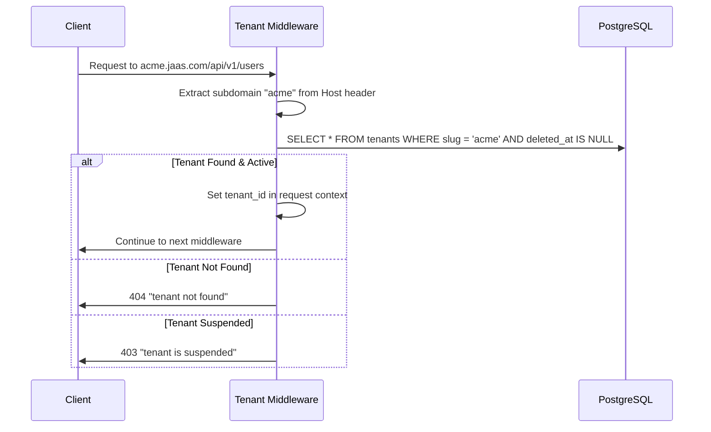

---

### Service Interactions

#### Service Dependency Map

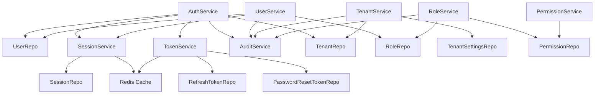

#### Key Service Responsibilities

| Service | Responsibility |
|---------|---------------|
| **AuthService** | Orchestrates login, logout, refresh, forgot-password, reset-password. Coordinates between UserRepo, SessionService, TokenService. |
| **UserService** | User CRUD, invitation, deactivation. Validates role assignments. |
| **TenantService** | Tenant CRUD, activation, suspension. Manages tenant settings. |
| **RoleService** | Role CRUD. Manages role-permission and user-role assignments. |
| **PermissionService** | Read-only permission listing. |
| **SessionService** | Session creation, validation, revocation. Uses Redis for fast lookups. |
| **TokenService** | Refresh token and password reset token generation, validation, rotation. |
| **AuditService** | Audit log creation. Accepts audit entries from all other services. |

---

### Request Flow

#### Standard Authenticated Request Flow

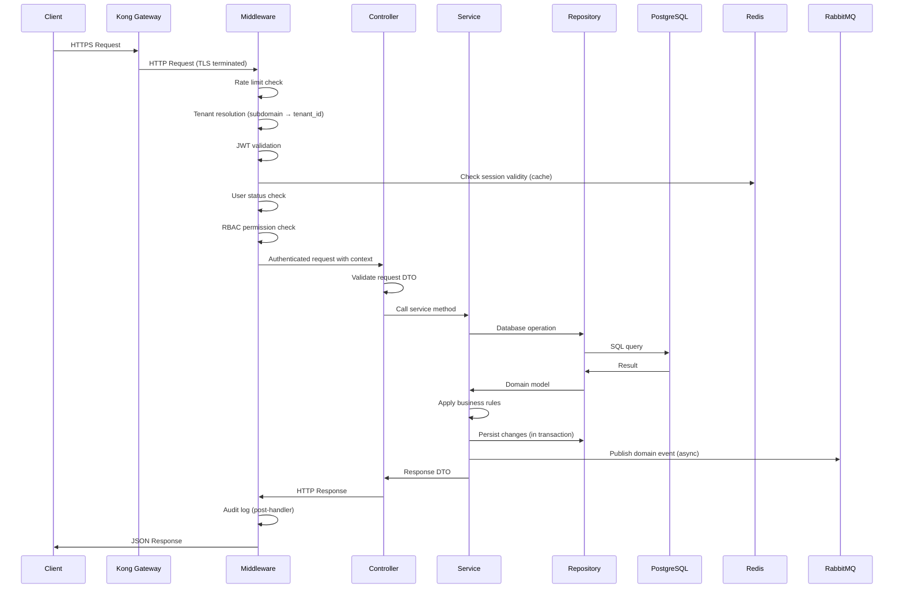

---

### Authentication Flow

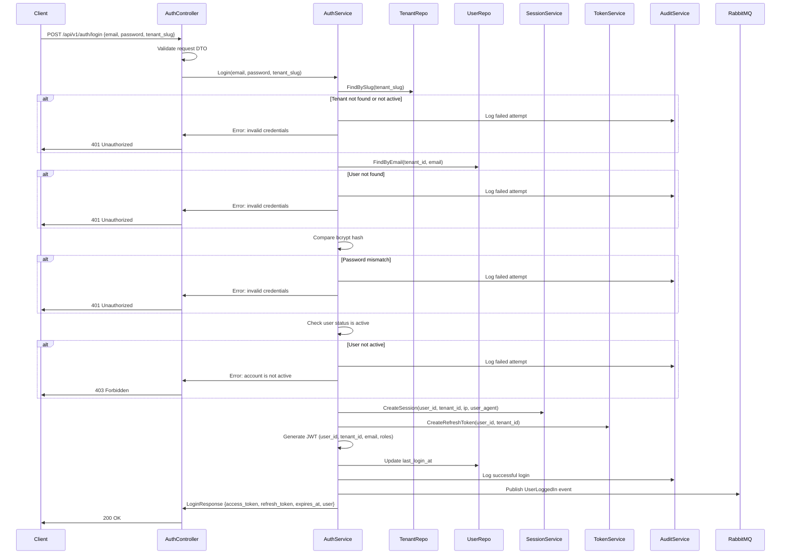

---

### Authorization Flow

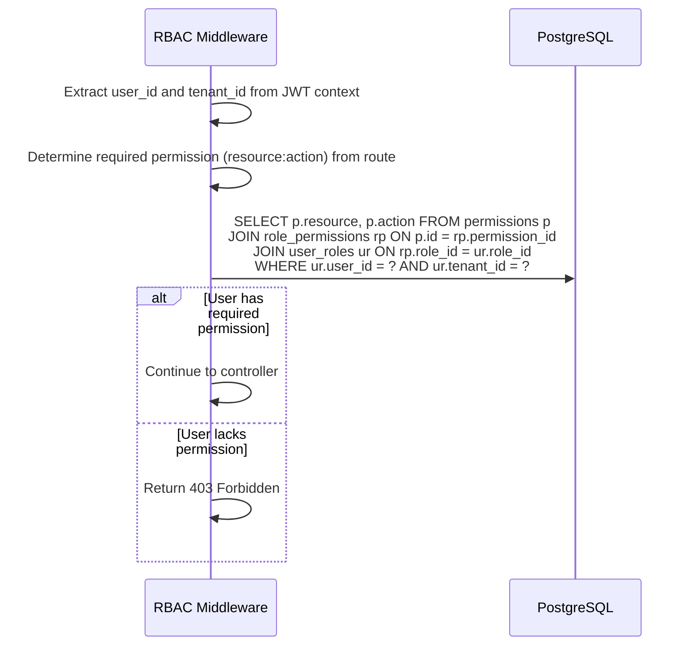

---

### Dependency Graph

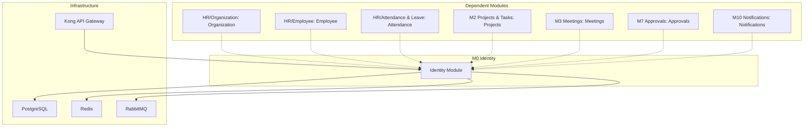

---

### Database Interaction

#### Connection Management

- Use GORM's built-in connection pooling
- Maximum open connections: 25
- Maximum idle connections: 10
- Connection max lifetime: 5 minutes
- Connection max idle time: 1 minute

#### Transaction Strategy

| Operation | Transaction Required | Reason |
|-----------|---------------------|--------|
| Create User with Roles | Yes | Writes to `users` and `user_roles` |
| Delete Role | Yes | Deletes from `roles`, `user_roles`, and `role_permissions` |
| Login | Yes | Creates `session`, creates `refresh_token`, updates `last_login_at` |
| Reset Password | Yes | Updates `password_hash`, revokes all sessions and refresh tokens, marks token used |
| Deactivate User | Yes | Updates user status, revokes all sessions and refresh tokens |
| Suspend Tenant | No | Single row update |
| Create Audit Log | No | Single insert, best-effort |

#### Query Patterns

All tenant-scoped queries MUST include `WHERE tenant_id = ?` to enforce isolation:

```sql
-- CORRECT: Tenant-scoped query
SELECT * FROM users WHERE tenant_id = $1 AND email = $2 AND deleted_at IS NULL

-- WRONG: Missing tenant isolation
SELECT * FROM users WHERE email = $1 AND deleted_at IS NULL
```

---

### Cache Interaction (Redis)

#### Cache Strategy

| Data | Cache Key Pattern | TTL | Strategy |
|------|------------------|-----|----------|
| Session validity | `session:{session_id}` | 24 hours | Write-through on create, invalidate on revoke |
| User permissions | `perms:{user_id}:{tenant_id}` | 5 minutes | Cache-aside, invalidate on role/permission change |
| Rate limit counters | `rate:{ip}:{endpoint}` | 15 minutes | Sliding window counter |
| Token blacklist | `blacklist:{token_jti}` | 15 minutes (matches JWT TTL) | Write on logout/revoke |

#### Cache Invalidation

| Event | Invalidated Keys |
|-------|-----------------|
| Logout | `session:{session_id}`, `blacklist:{jti}` (add) |
| User Deactivate | `session:{all_user_sessions}`, `perms:{user_id}:*` |
| Role Assign/Revoke | `perms:{user_id}:{tenant_id}` |
| Permission Assign/Revoke | `perms:{all_users_with_role}:{tenant_id}` |
| Tenant Suspend | `session:{all_tenant_sessions}` |

---

### Queue Interaction (RabbitMQ)

#### Exchange Configuration

| Exchange | Type | Durable | Purpose |
|----------|------|---------|---------|
| `jaas.identity.events` | Topic | Yes | All M0 Identity domain events |

#### Queue Bindings

| Queue | Routing Key Pattern | Consumer |
|-------|-------------------|----------|
| `jaas.notifications.identity` | `identity.user.*` | M10 Notifications |
| `jaas.audit.identity` | `identity.#` | Audit archival service |
| `jaas.org.identity` | `identity.tenant.*`, `identity.user.created` | HR/Organization (Organization) |

#### Publishing Pattern

Events are published asynchronously after the database transaction commits. If RabbitMQ is unavailable:
1. Log the failure with full event payload
2. Store the failed event in a `failed_events` table (dead letter persistence)
3. A background worker retries failed events with exponential backoff

---

### Future Scalability Considerations

#### Horizontal Scaling

- M0 Identity is stateless (sessions in Redis, data in PostgreSQL). Multiple instances can run behind a load balancer.
- JWT validation is self-contained (no database hit for token verification itself), enabling high throughput.

#### Database Scaling

- Read replicas for user/role/permission queries
- Partitioned audit logs by month for efficient querying and archival
- Connection pooling via PgBouncer for high-concurrency scenarios

#### Cache Scaling

- Redis Cluster for high availability
- Separate Redis instance for rate limiting vs. session caching

#### Event Processing

- Multiple queue consumers for parallel event processing
- RabbitMQ clustering for message durability
- Dead letter queues for poison message handling

## Architecture and workflows

> [!TIP]
> * An editable **Draw.io** version of this architecture diagram is saved locally in this repository at [architecture.drawio](file:///c:/Users/yashwanth/Desktop/_AJASS/docs/modules/m0-identity-access/architecture.drawio).
> * The raw **Mermaid** text file is saved at [architecture.mermaid](file:///c:/Users/yashwanth/Desktop/_AJASS/docs/modules/m0-identity-access/architecture.mermaid). You can copy the code into any Mermaid renderer or online live editor.

This document provides a clean architectural overview, detailed system workflows, and technical rationales for **M0 Identity (Tenant + Identity + RBAC)** foundation of the JAAS platform.

---

### 1. Clean Architectural Diagram

The system is designed following **Clean Architecture** principles. Dependencies flow inward: HTTP and infrastructure layers depend on services, which depend on repositories and domain models.

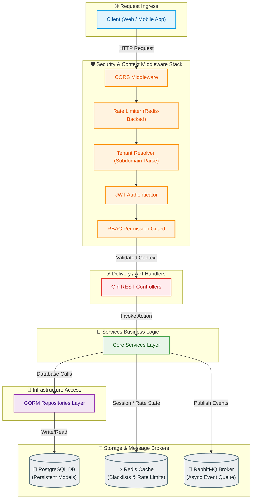

---

### 2. Core Workflows

#### A. Tenant Signup & Onboarding Workflow

This flow ensures new organizations register cleanly with automatic system roles provisioned.

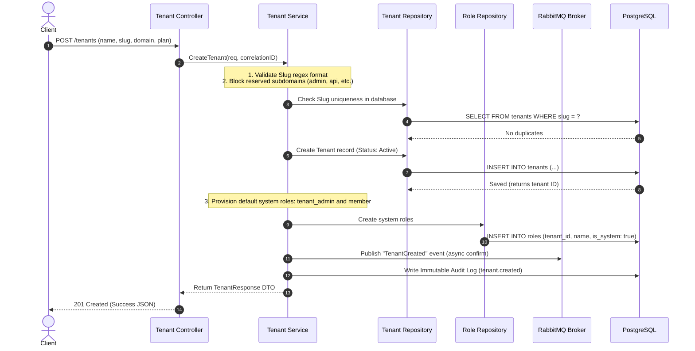

---

#### B. User Signin & Authentication Workflow

This flow authenticates users, starts active sessions, and deploys security tokens (JWT + Opaque Refresh).

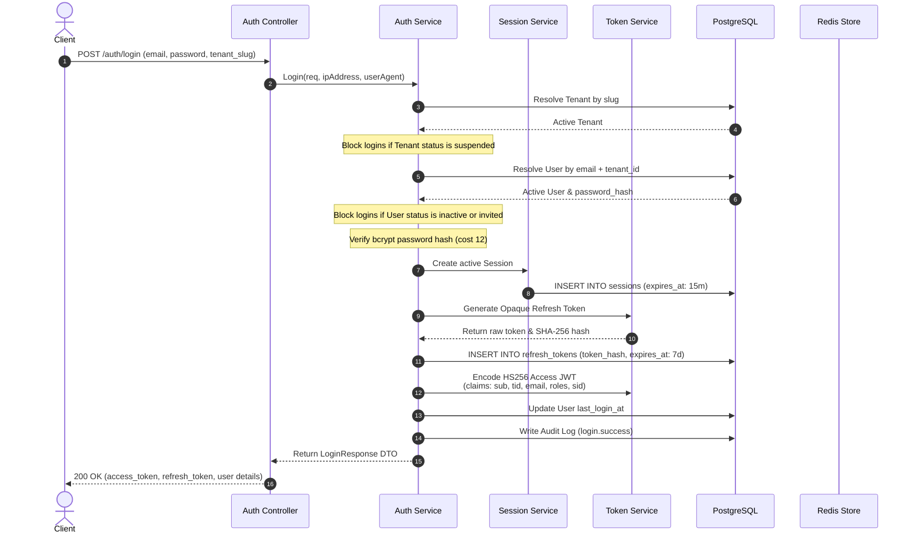

---

#### C. Refresh Token Rotation & Reuse Detection (RT-005)

To prevent session hijacks, we rotate refresh tokens on every use and implement absolute reuse detection.

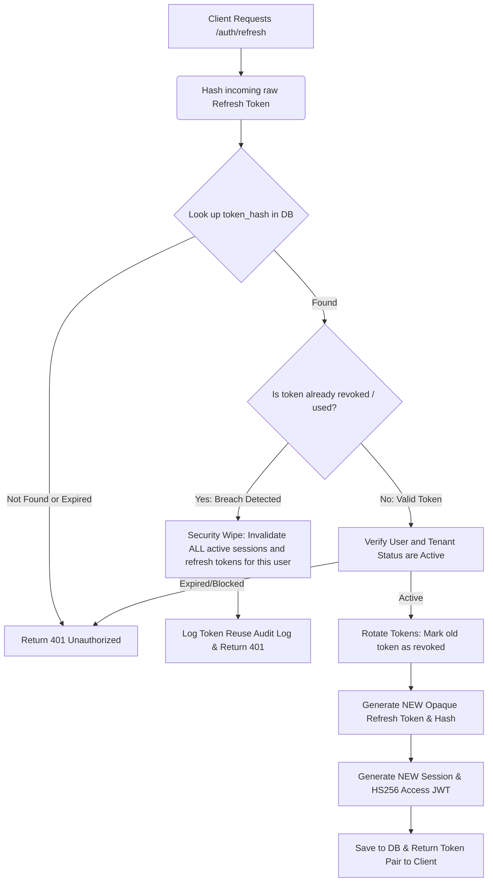

---

### 3. Technology Stack Rationale

#### A. Why Redis?
1. **Low-Latency Session Verification**: Rather than hitting PostgreSQL on every API call to confirm a user's session validity, the [auth](file:///c:/Users/yashwanth/Desktop/_AJASS/backend/internal/identity/middleware/auth.go) middleware queries Redis for blacklisted sessions.
2. **Instant JWT Blacklisting**: On logout, access tokens cannot be deleted from a client's device, so their `sid` (session ID) is blacklisted in Redis with a 15-minute TTL (matching access token expiration), resolving stateless logout invalidation.
3. **High-Performance Counters**: Sliding window rate limits require fast memory operations that Redis handles natively via atomic key incrementation.

#### B. Why RabbitMQ?
1. **Decoupled Architecture**: When a tenant or user is created, notifications (emails, SMS) or downstream sync services need to run. RabbitMQ allows the Identity service to publish a lightweight event and exit immediately without waiting for secondary processes.
2. **Reliability & Eventual Consistency**: RabbitMQ features **Publish Confirms** and durable queues. If downstream services (e.g. notification consumer) are down, events are safe in the broker and processed as soon as consumers reconnect.
3. **Asynchronous Audit Scopes**: Immutable security audit logs are written to the database asynchronously via events queue consumers, protecting the primary API thread from DB write latencies.

#### C. Why Rate Limiters?
1. **Brute-Force Attack Prevention**: Limits access to critical authorization endpoints (`/auth/login`, `/auth/forgot-password`). Brute-forcing passwords is capped at 10 requests per 15 minutes, blocking bots.
2. **Resource Exhaustion Mitigations**: Prevents bad actors from spawning high volumes of costly cryptographic actions (like Bcrypt password hashes which run at work cost 12, taking significant CPU cycles).
3. **Fail-Safe Fallback**: If Redis experiences connection outages, the rate limiter middleware is designed to **fail-open**—logging warning signals but allowing legitimate requests to bypass, prioritizing platform availability.

## Security

---

### Threat Model

#### Assets Under Protection

| Asset | Classification | Impact if Compromised |
|-------|---------------|----------------------|
| User credentials (passwords) | Critical | Full account takeover |
| JWT signing keys | Critical | Complete authentication bypass |
| Refresh tokens | High | Persistent unauthorized access |
| Session data | High | Session hijacking |
| Tenant data | High | Data breach, regulatory violation |
| Audit logs | Medium | Cover tracks for attackers |
| MFA secrets | Critical | Bypass second factor |
| Password reset tokens | High | Account takeover |

#### Threat Actors

| Actor | Capability | Motivation |
|-------|-----------|------------|
| External attacker | Network access, automated tools | Data theft, ransomware |
| Malicious tenant user | Authenticated access within tenant | Privilege escalation, data exfiltration |
| Compromised insider | Valid credentials, knowledge of system | Data theft, sabotage |
| Competitor | Social engineering, credential stuffing | Business intelligence |

#### STRIDE Analysis

| Threat | Category | Attack Vector | Mitigation |
|--------|----------|--------------|------------|
| T1 | **S**poofing | Stolen JWT used for impersonation | Short JWT TTL (15 min), token blacklisting on logout |
| T2 | **T**ampering | Modified JWT claims to escalate privileges | JWT signature verification (HMAC-SHA256 or RS256), claims validated against DB |
| T3 | **R**epudiation | User denies performing an action | Immutable audit logs with user_id, IP, timestamp |
| T4 | **I**nformation Disclosure | Enumeration of valid emails via login/forgot-password | Generic error messages, constant-time comparison |
| T5 | **D**enial of Service | Brute-force login flooding | Rate limiting per IP and per account |
| T6 | **E**levation of Privilege | Cross-tenant data access via tenant_id manipulation | JWT tenant_id validated against subdomain, all queries filtered by tenant_id |
| T7 | **S**poofing | Refresh token theft for persistent access | Refresh token rotation, reuse detection (revoke all on reuse) |
| T8 | **I**nformation Disclosure | Password hash exposure via API response | Never return password_hash in any API response |
| T9 | **T**ampering | SQL injection via input fields | GORM parameterized queries, input validation |
| T10 | **E**levation of Privilege | Modifying own role assignments | RBAC enforcement — only users with `users:update` permission can assign roles |

---

### Authentication Strategy

#### Primary Authentication: Email + Password + Tenant Slug

1. User submits `email`, `password`, and `tenant_slug`
2. System resolves tenant from slug
3. System looks up user by email within tenant
4. System compares password against bcrypt hash
5. On success: issue JWT access token + opaque refresh token
6. On failure: return generic "invalid credentials" (no information leakage)

#### Token Architecture

```
┌──────────────────────────────────────────────────────────────┐
│                    Token Lifecycle                            │
│                                                              │
│  Login → JWT (15 min) + Refresh Token (7 days)               │
│                                                              │
│  Access API → JWT validated (signature + expiry + claims)    │
│                                                              │
│  Token expires → Client uses refresh token to get new JWT    │
│                                                              │
│  Refresh → Old refresh token revoked, new pair issued        │
│                                                              │
│  Logout → Session revoked, refresh token revoked,            │
│           JWT JTI blacklisted in Redis                       │
└──────────────────────────────────────────────────────────────┘
```

#### MFA Strategy

When MFA is enabled for a user:

1. Credential validation succeeds → return partial response with `mfa_required: true`
2. Client submits MFA code to a verification endpoint
3. On valid MFA → issue full JWT + refresh token
4. On invalid MFA → return error, increment MFA failure counter
5. After 5 failed MFA attempts → lock MFA for 15 minutes

---

### Authorization Strategy

#### RBAC Model

```
User ──[has many]──→ UserRole ──[has one]──→ Role ──[has many]──→ RolePermission ──[has one]──→ Permission
                                              │
                                    tenant-scoped
```

#### Permission Format

```
{resource}:{action}
```

Examples:
- `users:create` — create a new user
- `users:read` — view user details
- `users:update` — update user profile, assign roles
- `users:delete` — delete a user
- `roles:create` — create a new role
- `roles:read` — list roles
- `roles:update` — update role, assign permissions
- `roles:delete` — delete a role
- `permissions:read` — list permissions
- `tenants:create` — create a tenant (Super Admin)
- `tenants:read` — view tenant details (Super Admin)
- `tenants:update` — update tenant, activate, suspend (Super Admin)

#### Permission Check Flow

1. Extract `user_id` and `tenant_id` from JWT context
2. Query user's permissions: `SELECT DISTINCT p.resource, p.action FROM permissions p JOIN role_permissions rp ON p.id = rp.permission_id JOIN user_roles ur ON rp.role_id = ur.role_id WHERE ur.user_id = ? AND ur.tenant_id = ?`
3. Check if the required permission exists in the result set
4. If present → allow. If absent → 403 Forbidden.
5. Cache the result in Redis with 5-minute TTL

#### Super Admin Authorization

Super Admin is a special role with unrestricted access to tenant management endpoints. Identification:
- The Super Admin belongs to a platform-level tenant (e.g., slug: `jaas-platform`)
- The Super Admin role has a special system role flag
- Tenant management endpoints (`/api/v1/tenants/*`) skip subdomain-based tenant resolution and instead verify Super Admin status

---

### JWT Strategy

#### Token Structure

**Header**:
```json
{
  "alg": "HS256",
  "typ": "JWT"
}
```

**Payload Claims**:

| Claim | Type | Description |
|-------|------|-------------|
| `sub` | string (UUID) | User ID |
| `tid` | string (UUID) | Tenant ID |
| `email` | string | User email |
| `roles` | []string | Array of role names |
| `sid` | string (UUID) | Session ID |
| `jti` | string (UUID) | Unique token identifier |
| `iat` | number | Issued-at timestamp (Unix epoch) |
| `exp` | number | Expiration timestamp (Unix epoch, iat + 900s) |
| `iss` | string | Issuer: "jaas-identity" |

#### Signing

| Property | Value |
|----------|-------|
| Algorithm | HS256 (HMAC-SHA256) for initial implementation. Migrate to RS256 (RSA) for production multi-service environments. |
| Secret | 256-bit key stored in environment variable `JWT_SECRET`. Never hardcoded. |
| Key Rotation | Support key rotation via `JWT_SECRET_PREVIOUS` for graceful rollover. Verify with current key first, fall back to previous. |

#### Validation Steps

1. Parse and decode the JWT
2. Verify signature using `JWT_SECRET`
3. Check `exp` > current time
4. Check `iss` == "jaas-identity"
5. Check `jti` is not in the Redis blacklist
6. Extract `sub` (user_id), `tid` (tenant_id), `sid` (session_id)
7. Verify `tid` matches subdomain-resolved tenant_id

---

### Refresh Token Rotation

#### Token Generation

1. Generate 32 bytes of cryptographically secure random data (`crypto/rand`)
2. Base64-URL encode the random bytes → this is the raw refresh token returned to the client
3. SHA-256 hash the raw token → store the hash in `refresh_tokens.token_hash`
4. Set `expires_at` to current time + 7 days

#### Rotation Flow

```
Client sends refresh_token →
  Server hashes it →
    Looks up token_hash in DB →
      If found AND not revoked AND not expired:
        1. Revoke old token (set revoked_at)
        2. Generate new refresh token
        3. Issue new JWT
        4. Return new access_token + refresh_token
      If found AND revoked (REUSE DETECTED):
        1. Revoke ALL refresh tokens for this user
        2. Revoke ALL sessions for this user
        3. Return 401 with security alert
      If not found or expired:
        Return 401
```

#### Reuse Detection Rationale

If a revoked refresh token is presented, it means either:
- The token was intercepted by an attacker, OR
- A legitimate client is using a stale token (e.g., due to a race condition)

In both cases, the safest action is to revoke everything and force re-authentication.

---

### Password Hashing

| Property | Value |
|----------|-------|
| Algorithm | bcrypt |
| Cost Factor | 12 |
| Library | `golang.org/x/crypto/bcrypt` |
| Storage Format | `$2a$12$...` (standard bcrypt output) |

#### Password Requirements

| Requirement | Value |
|------------|-------|
| Minimum length | 8 characters |
| Maximum length | 72 bytes (bcrypt limit) |
| Complexity | Not enforced in v1 (consider adding in v2: uppercase, lowercase, digit, special char) |

#### Hashing Rules

1. Hash on creation: `bcrypt.GenerateFromPassword([]byte(password), 12)`
2. Hash on reset: same as creation
3. Compare on login: `bcrypt.CompareHashAndPassword(hash, []byte(password))`
4. Never store plaintext. Never log plaintext. Never return hash in API responses.
5. Use constant-time comparison (bcrypt does this internally).

---

### Rate Limiting

#### Rate Limit Configuration

| Endpoint | Rate Limit | Window | Key |
|----------|-----------|--------|-----|
| POST /auth/login | 10 requests | 15 minutes | Per email + tenant_slug |
| POST /auth/login | 100 requests | 15 minutes | Per IP address |
| POST /auth/forgot-password | 5 requests | 1 hour | Per email + tenant_slug |
| POST /auth/reset-password | 10 requests | 1 hour | Per IP address |
| POST /auth/refresh | 30 requests | 15 minutes | Per user_id |
| All other endpoints | 100 requests | 1 minute | Per user_id |

#### Implementation

- Use Redis-backed sliding window counter
- Key format: `rate:{endpoint}:{identifier}:{window_start}`
- Return `429 Too Many Requests` with `Retry-After` header when limit exceeded
- Rate limit headers on every response:
  - `X-RateLimit-Limit`: Maximum requests allowed
  - `X-RateLimit-Remaining`: Remaining requests in window
  - `X-RateLimit-Reset`: Unix timestamp when window resets

---

### Brute Force Protection

#### Account-Level Protection

| Measure | Threshold | Action |
|---------|----------|--------|
| Failed login attempts | 10 per account per 15 min | Return 429, log security event |
| Failed MFA attempts | 5 per account per 15 min | Lock MFA verification for 15 min |
| Failed password reset | 10 per token per 1 hour | Return 429 |

#### IP-Level Protection

| Measure | Threshold | Action |
|---------|----------|--------|
| Login attempts from single IP | 100 per 15 min | Return 429 for all login attempts from that IP |
| Password reset from single IP | 20 per 1 hour | Return 429 |

#### Account Lockout (Future Enhancement)

In v2, implement progressive lockout:
1. After 10 failed attempts → 15-minute cooldown
2. After 20 failed attempts → 1-hour cooldown
3. After 30 failed attempts → account locked, requires admin unlock

---

### Audit Logging

#### What to Log

| Event Category | Actions |
|---------------|---------|
| Authentication | login.success, login.failed, logout, token.refresh |
| User Management | user.created, user.updated, user.deactivated, user.invited |
| Role Management | role.created, role.updated, role.deleted, role.assigned, role.revoked |
| Permission Management | permission.assigned, permission.revoked |
| Tenant Management | tenant.created, tenant.updated, tenant.activated, tenant.suspended |
| Password | password.reset_requested, password.reset_completed |
| Security | token.reuse_detected, rate_limit.exceeded |

#### Audit Log Fields

| Field | Source |
|-------|--------|
| tenant_id | JWT context or request body |
| user_id | JWT context (null for failed logins) |
| action | Predefined action string |
| resource | Resource type string |
| resource_id | UUID of affected resource |
| metadata | JSON with change details (old values, new values, reason) |
| ip_address | `X-Forwarded-For` or `RemoteAddr` |
| user_agent | `User-Agent` header |
| created_at | Server timestamp (UTC) |

#### Immutability Enforcement

- No UPDATE operations on `audit_logs` table
- No DELETE operations on `audit_logs` table
- The repository interface exposes only `Create` and `FindMany` methods
- GORM model does not include `updated_at` or `deleted_at` fields
- Database-level trigger (optional) to prevent UPDATE/DELETE at the DB layer

---

### Encryption

#### Data at Rest

| Data | Encryption |
|------|-----------|
| Passwords | bcrypt hash (one-way) |
| Refresh tokens | SHA-256 hash (one-way) |
| Password reset tokens | SHA-256 hash (one-way) |
| MFA secrets | AES-256-GCM encryption (two-way, decryptable for verification) |
| Database | PostgreSQL TDE or filesystem-level encryption (infrastructure) |
| Redis | Redis AUTH + TLS in production |

#### Data in Transit

| Path | Encryption |
|------|-----------|
| Client → Kong | TLS 1.2+ (mandatory in production) |
| Kong → Application | Plain HTTP (internal network, TLS terminated at gateway) |
| Application → PostgreSQL | TLS in production (`sslmode=require`) |
| Application → Redis | TLS in production |
| Application → RabbitMQ | TLS in production |

#### Key Management

| Key | Storage | Rotation |
|-----|---------|----------|
| JWT signing secret | Environment variable `JWT_SECRET` | Rotate every 90 days, support dual-key verification during rollover |
| MFA encryption key | Environment variable `MFA_ENCRYPTION_KEY` | Rotate with re-encryption of all MFA secrets |
| Database password | Environment variable or secrets manager | Rotate per organization policy |

---

### OWASP Considerations

#### OWASP Top 10 (2021) Mapping

| # | Threat | Relevance | Mitigation |
|---|--------|-----------|------------|
| A01 | Broken Access Control | **High** | RBAC middleware on every endpoint. Tenant isolation via tenant_id. JWT validation. |
| A02 | Cryptographic Failures | **High** | bcrypt for passwords. SHA-256 for tokens. AES-256 for MFA. TLS in transit. |
| A03 | Injection | **Medium** | GORM parameterized queries. Input validation on all DTOs. |
| A04 | Insecure Design | **Medium** | Clean Architecture. Security by design. Threat modeling. |
| A05 | Security Misconfiguration | **Medium** | No default credentials. Environment-based config. Strict CORS. |
| A06 | Vulnerable Components | **Low** | Regular dependency updates. `go mod audit`. |
| A07 | Identification and Auth Failures | **High** | bcrypt, JWT rotation, MFA, rate limiting, brute-force protection. |
| A08 | Software and Data Integrity Failures | **Medium** | JWT signature verification. Immutable audit logs. |
| A09 | Security Logging and Monitoring Failures | **High** | Comprehensive audit logging. Failed login tracking. |
| A10 | Server-Side Request Forgery | **Low** | No user-controlled URL fetching in M0 Identity. |

#### Additional OWASP Recommendations

| Recommendation | Implementation |
|---------------|---------------|
| Secure HTTP headers | `X-Content-Type-Options: nosniff`, `X-Frame-Options: DENY`, `Strict-Transport-Security`, `X-XSS-Protection: 0` (modern browsers), `Content-Security-Policy` |
| CORS configuration | Whitelist specific origins. No `*` in production. |
| Cookie security (if applicable) | `HttpOnly`, `Secure`, `SameSite=Strict` |
| Error handling | Never expose stack traces or internal error details to clients |
| Input length limits | Enforce max length on all string inputs at validation layer |

---

### Security Checklist

#### Pre-Production Checklist

- [ ] JWT signing secret is at least 256 bits and stored in environment variable
- [ ] JWT signing secret is not committed to source control
- [ ] bcrypt cost factor is set to 12
- [ ] All passwords are hashed before storage
- [ ] No plaintext passwords in logs, responses, or database
- [ ] Refresh token rotation is implemented
- [ ] Refresh token reuse detection is implemented
- [ ] Password reset tokens expire after 1 hour
- [ ] Password reset tokens are single-use
- [ ] Generic error messages on login/forgot-password (no enumeration)
- [ ] Rate limiting is configured for all auth endpoints
- [ ] CORS is configured with specific origins (no wildcard)
- [ ] TLS is enforced in production
- [ ] Database connections use TLS in production
- [ ] All API responses follow consistent error format (no stack traces)
- [ ] Audit logs are immutable (no UPDATE/DELETE)
- [ ] All tenant-scoped queries include tenant_id filter
- [ ] JWT tenant_id is validated against subdomain
- [ ] MFA secrets are encrypted at rest
- [ ] Session timeout is enforced
- [ ] Token blacklisting is implemented for logout
- [ ] Input validation is applied to all request DTOs
- [ ] SQL injection is prevented via parameterized queries
- [ ] Dependency vulnerabilities are scanned (`go mod audit`)
- [ ] Security headers are set on all responses

## Component diagram


## Sequence diagrams

```mermaid
# Module 0 — Sequence Diagrams

All sequence diagrams use Mermaid syntax and document the full request lifecycle for each core operation.

---

## 1. Login

```mermaid
sequenceDiagram
    participant C as Client
    participant CT as AuthController
    participant V as Validator
    participant AS as AuthService
    participant TR as TenantRepo
    participant UR as UserRepo
    participant SS as SessionService
    participant TS as TokenService
    participant AL as AuditService
    participant MQ as RabbitMQ

    C->>CT: POST /api/v1/auth/login
    Note right of C: {email, password, tenant_slug}

    CT->>V: Validate LoginRequest
    alt Validation fails
        V-->>CT: ValidationError
        CT-->>C: 400 Bad Request
    end

    CT->>AS: Login(request)

    AS->>TR: FindBySlug(tenant_slug)
    alt Tenant not found
        AS->>AL: LogAudit(action: user.login.failed, metadata: {reason: invalid_tenant})
        AS-->>CT: ErrInvalidCredentials
        CT-->>C: 401 Unauthorized
    end

    AS->>AS: Check tenant.Status == "active"
    alt Tenant suspended/inactive
        AS->>AL: LogAudit(action: user.login.failed, metadata: {reason: tenant_suspended})
        AS-->>CT: ErrTenantSuspended
        CT-->>C: 403 Forbidden
    end

    AS->>UR: FindByEmail(tenant_id, email)
    alt User not found
        AS->>AL: LogAudit(action: user.login.failed, metadata: {reason: invalid_email})
        AS-->>CT: ErrInvalidCredentials
        CT-->>C: 401 Unauthorized
    end

    AS->>AS: bcrypt.CompareHashAndPassword(user.PasswordHash, password)
    alt Password mismatch
        AS->>AL: LogAudit(action: user.login.failed, metadata: {reason: invalid_password, user_id})
        AS-->>CT: ErrInvalidCredentials
        CT-->>C: 401 Unauthorized
    end

    AS->>AS: Check user.Status == "active"
    alt User not active
        AS->>AL: LogAudit(action: user.login.failed, metadata: {reason: user_not_active})
        AS-->>CT: ErrAccountNotActive
        CT-->>C: 403 Forbidden
    end

    rect rgb(200, 230, 200)
        Note over AS,TS: Begin Transaction
        AS->>SS: CreateSession(user_id, tenant_id, ip, user_agent)
        AS->>TS: GenerateRefreshToken(user_id, tenant_id)
        AS->>UR: UpdateLastLoginAt(user_id)
        Note over AS,TS: Commit Transaction
    end

    AS->>AS: GenerateJWT(user_id, tenant_id, email, roles)
    AS->>AL: LogAudit(action: user.login.success, user_id, tenant_id)
    AS->>MQ: Publish(identity.user.logged_in, {user_id, tenant_id, timestamp})

    AS-->>CT: LoginResponse
    CT-->>C: 200 OK {access_token, refresh_token, expires_at, user}
```

---

## 2. Logout

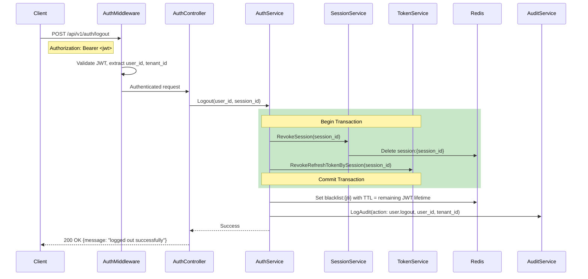

---

## 3. Refresh Token

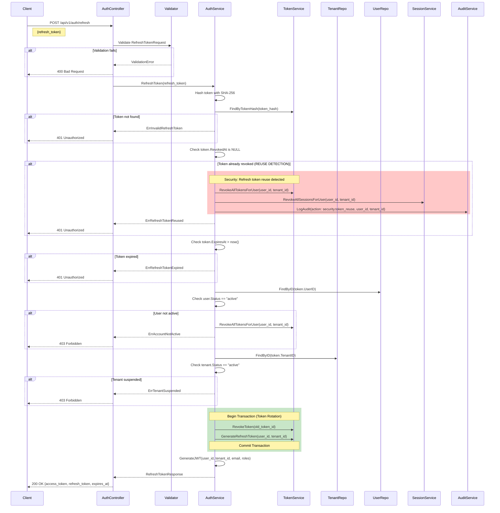

---

## 4. Forgot Password

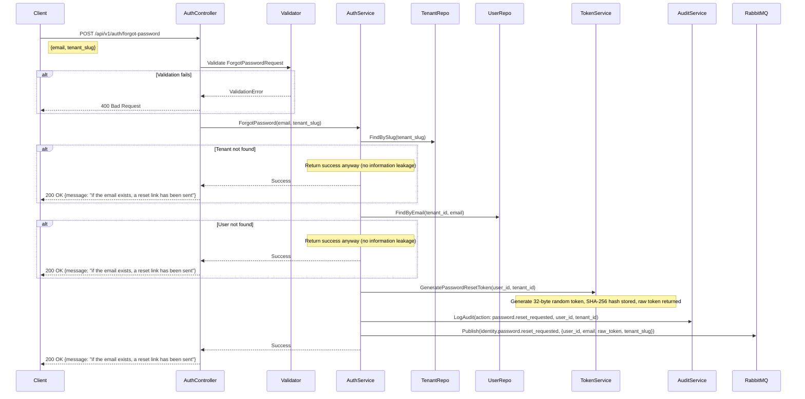

---

## 5. Reset Password

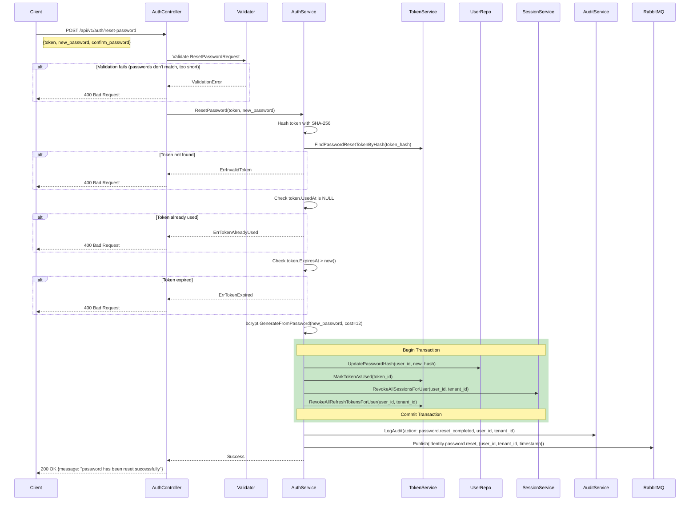

---

## 6. Invite User

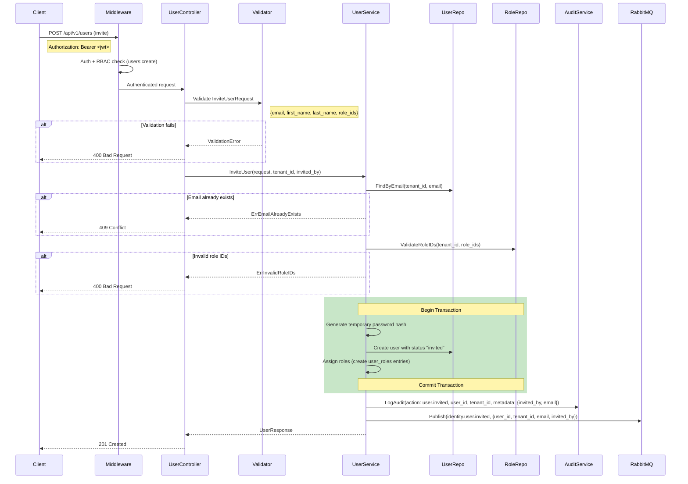

---

## 7. Assign Role

```mermaid
sequenceDiagram
    participant C as Client
    participant MW as Middleware
    participant CT as RoleController
    participant V as Validator
    participant RS as RoleService
    participant UR as UserRepo
    participant RR as RoleRepo
    participant AL as AuditService
    participant RD as Redis
    participant MQ as RabbitMQ

    C->>MW: POST /api/v1/users/{id}/roles
    Note right of C: {role_ids}
    MW->>MW: Auth + RBAC check (users:update)
    MW->>CT: Authenticated request

    CT->>V: Validate AssignRoleRequest
    alt Validation fails
        V-->>CT: ValidationError
        CT-->>C: 400 Bad Request
    end

    CT->>RS: AssignRoles(user_id, tenant_id, role_ids, assigned_by)

    RS->>UR: FindByID(user_id)
    alt User not found or different tenant
        RS-->>CT: ErrUserNotFound
        CT-->>C: 404 Not Found
    end

    RS->>RR: ValidateRoleIDs(tenant_id, role_ids)
    alt Invalid role IDs
        RS-->>CT: ErrInvalidRoleIDs
        CT-->>C: 400 Bad Request
    end

    loop For each role_id
        RS->>RS: Check if user_role already exists (idempotent)
        alt Not assigned yet
            RS->>RS: Create user_role entry
        end
    end

    RS->>RD: Invalidate perms:{user_id}:{tenant_id}
    RS->>AL: LogAudit(action: role.assigned, user_id, tenant_id, metadata: {role_ids, assigned_by})
    RS->>MQ: Publish(identity.role.assigned, {user_id, role_ids, tenant_id, assigned_by})

    RS-->>CT: Success
    CT-->>C: 200 OK {message: "roles assigned successfully"}
```

---

## 8. Assign Permission

```mermaid
sequenceDiagram
    participant C as Client
    participant MW as Middleware
    participant CT as RoleController
    participant V as Validator
    participant RS as RoleService
    participant RR as RoleRepo
    participant PR as PermissionRepo
    participant AL as AuditService
    participant RD as Redis
    participant MQ as RabbitMQ

    C->>MW: POST /api/v1/roles/{id}/permissions
    Note right of C: {permission_ids}
    MW->>MW: Auth + RBAC check (roles:update)
    MW->>CT: Authenticated request

    CT->>V: Validate AssignPermissionsRequest
    alt Validation fails
        V-->>CT: ValidationError
        CT-->>C: 400 Bad Request
    end

    CT->>RS: AssignPermissions(role_id, tenant_id, permission_ids)

    RS->>RR: FindByID(role_id)
    alt Role not found or different tenant
        RS-->>CT: ErrRoleNotFound
        CT-->>C: 404 Not Found
    end

    RS->>PR: ValidatePermissionIDs(permission_ids)
    alt Invalid permission IDs
        RS-->>CT: ErrInvalidPermissionIDs
        CT-->>C: 400 Bad Request
    end

    loop For each permission_id
        RS->>RS: Check if role_permission already exists (idempotent)
        alt Not assigned yet
            RS->>RS: Create role_permission entry
        end
    end

    RS->>RD: Invalidate perms for all users with this role
    RS->>AL: LogAudit(action: permission.assigned, tenant_id, metadata: {role_id, permission_ids})
    RS->>MQ: Publish(identity.permission.assigned, {role_id, permission_ids, tenant_id})

    RS-->>CT: Success
    CT-->>C: 200 OK {message: "permissions assigned successfully"}
```

---

## 9. Deactivate User

```mermaid
sequenceDiagram
    participant C as Client
    participant MW as Middleware
    participant CT as UserController
    participant US as UserService
    participant UR as UserRepo
    participant SS as SessionService
    participant TS as TokenService
    participant RD as Redis
    participant AL as AuditService
    participant MQ as RabbitMQ

    C->>MW: POST /api/v1/users/{id}/deactivate
    MW->>MW: Auth + RBAC check (users:update)
    MW->>CT: Authenticated request

    CT->>US: DeactivateUser(user_id, tenant_id)

    US->>UR: FindByID(user_id)
    alt User not found or different tenant
        US-->>CT: ErrUserNotFound
        CT-->>C: 404 Not Found
    end

    US->>US: Check user.Status != "inactive"
    alt Already inactive
        US-->>CT: ErrUserAlreadyInactive
        CT-->>C: 409 Conflict
    end

    rect rgb(200, 230, 200)
        Note over US,TS: Begin Transaction
        US->>UR: UpdateStatus(user_id, "inactive")
        US->>SS: RevokeAllSessionsForUser(user_id, tenant_id)
        US->>TS: RevokeAllRefreshTokensForUser(user_id, tenant_id)
        Note over US,TS: Commit Transaction
    end

    US->>RD: Delete session:* for user, Delete perms:{user_id}:*
    US->>AL: LogAudit(action: user.deactivated, user_id, tenant_id)
    US->>MQ: Publish(identity.user.deactivated, {user_id, tenant_id, timestamp})

    US-->>CT: Success
    CT-->>C: 200 OK {message: "user deactivated successfully"}
```

---

## 10. Suspend Tenant

```mermaid
sequenceDiagram
    participant C as Client
    participant MW as Middleware
    participant CT as TenantController
    participant TS as TenantService
    participant TR as TenantRepo
    participant AL as AuditService
    participant MQ as RabbitMQ

    C->>MW: POST /api/v1/tenants/{id}/suspend
    MW->>MW: Auth (Super Admin only)
    MW->>CT: Authenticated request

    CT->>TS: SuspendTenant(tenant_id)

    TS->>TR: FindByID(tenant_id)
    alt Tenant not found
        TS-->>CT: ErrTenantNotFound
        CT-->>C: 404 Not Found
    end

    TS->>TS: Check tenant.Status == "active"
    alt Not active
        TS-->>CT: ErrTenantAlreadySuspended
        CT-->>C: 409 Conflict
    end

    TS->>TR: UpdateStatus(tenant_id, "suspended")
    TS->>AL: LogAudit(action: tenant.suspended, tenant_id)
    TS->>MQ: Publish(identity.tenant.suspended, {tenant_id, timestamp})

    Note over TS: Existing sessions will fail at tenant middleware on next request

    TS-->>CT: TenantResponse
    CT-->>C: 200 OK
```

---

## 11. Activate Tenant

```mermaid
sequenceDiagram
    participant C as Client
    participant MW as Middleware
    participant CT as TenantController
    participant TS as TenantService
    participant TR as TenantRepo
    participant AL as AuditService
    participant MQ as RabbitMQ

    C->>MW: POST /api/v1/tenants/{id}/activate
    MW->>MW: Auth (Super Admin only)
    MW->>CT: Authenticated request

    CT->>TS: ActivateTenant(tenant_id)

    TS->>TR: FindByID(tenant_id)
    alt Tenant not found
        TS-->>CT: ErrTenantNotFound
        CT-->>C: 404 Not Found
    end

    TS->>TS: Check tenant.Status == "suspended"
    alt Not suspended
        TS-->>CT: ErrTenantAlreadyActive
        CT-->>C: 409 Conflict
    end

    TS->>TR: UpdateStatus(tenant_id, "active")
    TS->>AL: LogAudit(action: tenant.activated, tenant_id)
    TS->>MQ: Publish(identity.tenant.activated, {tenant_id, timestamp})

    TS-->>CT: TenantResponse
    CT-->>C: 200 OK
```

---

## 12. Session Validation (Middleware)

```mermaid
sequenceDiagram
    participant C as Client
    participant MW as AuthMiddleware
    participant RD as Redis
    participant DB as PostgreSQL

    C->>MW: Any authenticated request
    Note right of C: Authorization: Bearer <jwt>

    MW->>MW: Extract JWT from header
    MW->>MW: Verify JWT signature
    alt Invalid signature
        MW-->>C: 401 Unauthorized
    end

    MW->>MW: Check JWT expiration
    alt Expired
        MW-->>C: 401 Unauthorized
    end

    MW->>MW: Extract claims (user_id, tenant_id, session_id, jti)

    MW->>RD: Check blacklist:{jti}
    alt Token is blacklisted
        MW-->>C: 401 Unauthorized
    end

    MW->>RD: Check session:{session_id}
    alt Session found in cache
        MW->>MW: Verify session not revoked and not expired
        alt Session invalid
            MW-->>C: 401 Unauthorized
        end
    else Cache miss
        MW->>DB: SELECT * FROM sessions WHERE id = session_id
        alt Session not found or revoked or expired
            MW-->>C: 401 Unauthorized
        end
        MW->>RD: Cache session data
    end

    MW->>MW: Extract tenant_id from subdomain
    MW->>MW: Verify JWT tenant_id matches subdomain tenant_id
    alt Mismatch
        MW-->>C: 403 Forbidden
    end

    MW->>MW: Set user_id, tenant_id, roles in request context
    MW->>MW: Continue to next middleware / controller
```
```

## Database schema (DBML, design-time)

```dbml
// Module 0 — Database Schema (DBML Notation)
// https://dbml.dbdiagram.io/docs/
//
// Conventions:
//   - All table names: lowercase, plural, snake_case
//   - All column names: lowercase, snake_case
//   - Primary keys: UUID type, named "id"
//   - Foreign keys: {referenced_table_singular}_id
//   - Timestamps: created_at, updated_at (where mutable), deleted_at (soft delete)
//   - Indexes: idx_{table}_{column(s)}
//   - Unique constraints: uq_{table}_{column(s)}

Project JAAS_Module0 {
  database_type: 'PostgreSQL'
  Note: 'Module 0: Tenant + Identity + RBAC'
}

// ============================================================
// TENANTS
// ============================================================

Table tenants {
  id uuid [pk, note: 'UUIDv4 primary key']
  name varchar(255) [not null, note: 'Display name of the tenant organization']
  slug varchar(64) [unique, not null, note: 'URL-safe identifier for subdomain routing. Immutable after creation.']
  domain varchar(255) [unique, note: 'Custom domain if configured. Nullable.']
  status varchar(20) [not null, default: 'active', note: 'Enum: active, suspended, inactive']
  plan varchar(50) [not null, default: 'free', note: 'Subscription plan identifier']
  created_at timestamptz [not null, default: `now()`]
  updated_at timestamptz [not null, default: `now()`]
  deleted_at timestamptz [note: 'Soft delete timestamp. NULL = active record.']

  indexes {
    slug [name: 'idx_tenants_slug']
    domain [name: 'idx_tenants_domain']
    status [name: 'idx_tenants_status']
    deleted_at [name: 'idx_tenants_deleted_at']
  }

  Note: 'Root entity. Each tenant represents an isolated customer organization.'
}

// ============================================================
// TENANT SETTINGS
// ============================================================

Table tenant_settings {
  id uuid [pk]
  tenant_id uuid [not null, ref: > tenants.id, note: 'Owning tenant']
  key varchar(255) [not null, note: 'Setting key (e.g., timezone, locale, mfa_required)']
  value text [not null, note: 'Setting value as string']
  created_at timestamptz [not null, default: `now()`]
  updated_at timestamptz [not null, default: `now()`]

  indexes {
    (tenant_id, key) [unique, name: 'uq_tenant_settings_tenant_key']
    tenant_id [name: 'idx_tenant_settings_tenant_id']
  }

  Note: 'Key-value configuration scoped to a tenant.'
}

// ============================================================
// USERS
// ============================================================

Table users {
  id uuid [pk]
  tenant_id uuid [not null, ref: > tenants.id, note: 'Owning tenant']
  email varchar(255) [not null, note: 'User email address']
  password_hash varchar(255) [not null, note: 'bcrypt hashed password (cost 12)']
  first_name varchar(100) [not null]
  last_name varchar(100) [not null]
  phone varchar(20) [note: 'Nullable. E.164 format recommended.']
  avatar_url varchar(500) [note: 'Nullable. URL to profile image.']
  status varchar(20) [not null, default: 'active', note: 'Enum: active, inactive, invited, suspended']
  email_verified_at timestamptz [note: 'Nullable. Set when email is verified.']
  last_login_at timestamptz [note: 'Nullable. Updated on each successful login.']
  created_at timestamptz [not null, default: `now()`]
  updated_at timestamptz [not null, default: `now()`]
  deleted_at timestamptz [note: 'Soft delete timestamp']

  indexes {
    (tenant_id, email) [unique, name: 'uq_users_tenant_email']
    tenant_id [name: 'idx_users_tenant_id']
    email [name: 'idx_users_email']
    status [name: 'idx_users_status']
    deleted_at [name: 'idx_users_deleted_at']
  }

  Note: 'User identity within a tenant. Email is unique per tenant.'
}

// ============================================================
// ROLES
// ============================================================

Table roles {
  id uuid [pk]
  tenant_id uuid [not null, ref: > tenants.id, note: 'Owning tenant']
  name varchar(100) [not null, note: 'Role name, unique within tenant']
  description varchar(500) [note: 'Nullable. Human-readable description.']
  is_system boolean [not null, default: false, note: 'System roles cannot be deleted or renamed']
  created_at timestamptz [not null, default: `now()`]
  updated_at timestamptz [not null, default: `now()`]
  deleted_at timestamptz [note: 'Soft delete timestamp']

  indexes {
    (tenant_id, name) [unique, name: 'uq_roles_tenant_name']
    tenant_id [name: 'idx_roles_tenant_id']
    deleted_at [name: 'idx_roles_deleted_at']
  }

  Note: 'RBAC role scoped to a tenant. Binds permissions to users.'
}

// ============================================================
// PERMISSIONS
// ============================================================

Table permissions {
  id uuid [pk]
  resource varchar(100) [not null, note: 'Resource name (e.g., users, roles, tenants)']
  action varchar(50) [not null, note: 'Action name (e.g., create, read, update, delete)']
  description varchar(500) [note: 'Nullable. Human-readable description.']
  created_at timestamptz [not null, default: `now()`]
  updated_at timestamptz [not null, default: `now()`]

  indexes {
    (resource, action) [unique, name: 'uq_permissions_resource_action']
    resource [name: 'idx_permissions_resource']
  }

  Note: 'Global permission definitions. NOT tenant-scoped. Defines what can be done.'
}

// ============================================================
// USER ROLES (Join Table)
// ============================================================

Table user_roles {
  id uuid [pk]
  user_id uuid [not null, ref: > users.id, note: 'Assigned user']
  role_id uuid [not null, ref: > roles.id, note: 'Assigned role']
  tenant_id uuid [not null, ref: > tenants.id, note: 'Tenant scope']
  assigned_at timestamptz [not null, default: `now()`, note: 'When the role was assigned']
  assigned_by uuid [ref: > users.id, note: 'Nullable. User who made the assignment.']
  created_at timestamptz [not null, default: `now()`]
  updated_at timestamptz [not null, default: `now()`]

  indexes {
    (user_id, role_id, tenant_id) [unique, name: 'uq_user_roles_user_role_tenant']
    user_id [name: 'idx_user_roles_user_id']
    role_id [name: 'idx_user_roles_role_id']
    tenant_id [name: 'idx_user_roles_tenant_id']
  }

  Note: 'Many-to-many relationship between users and roles within a tenant.'
}

// ============================================================
// ROLE PERMISSIONS (Join Table)
// ============================================================

Table role_permissions {
  id uuid [pk]
  role_id uuid [not null, ref: > roles.id, note: 'Role receiving the permission']
  permission_id uuid [not null, ref: > permissions.id, note: 'Permission being granted']
  tenant_id uuid [not null, ref: > tenants.id, note: 'Tenant scope']
  created_at timestamptz [not null, default: `now()`]
  updated_at timestamptz [not null, default: `now()`]

  indexes {
    (role_id, permission_id, tenant_id) [unique, name: 'uq_role_permissions_role_perm_tenant']
    role_id [name: 'idx_role_permissions_role_id']
    permission_id [name: 'idx_role_permissions_permission_id']
    tenant_id [name: 'idx_role_permissions_tenant_id']
  }

  Note: 'Many-to-many relationship between roles and permissions within a tenant.'
}

// ============================================================
// SESSIONS
// ============================================================

Table sessions {
  id uuid [pk]
  user_id uuid [not null, ref: > users.id, note: 'Session owner']
  tenant_id uuid [not null, ref: > tenants.id, note: 'Tenant scope']
  ip_address varchar(45) [not null, note: 'IPv4 or IPv6 address']
  user_agent varchar(500) [not null, note: 'Browser/client user agent string']
  expires_at timestamptz [not null, note: 'Session expiry timestamp']
  revoked_at timestamptz [note: 'Nullable. Set when session is revoked.']
  created_at timestamptz [not null, default: `now()`]
  updated_at timestamptz [not null, default: `now()`]

  indexes {
    user_id [name: 'idx_sessions_user_id']
    tenant_id [name: 'idx_sessions_tenant_id']
    (user_id, tenant_id) [name: 'idx_sessions_user_tenant']
    expires_at [name: 'idx_sessions_expires_at']
  }

  Note: 'Active login session. Created on login, revoked on logout or deactivation.'
}

// ============================================================
// REFRESH TOKENS
// ============================================================

Table refresh_tokens {
  id uuid [pk]
  user_id uuid [not null, ref: > users.id, note: 'Token owner']
  tenant_id uuid [not null, ref: > tenants.id, note: 'Tenant scope']
  token_hash varchar(64) [unique, not null, note: 'SHA-256 hash of the opaque refresh token']
  expires_at timestamptz [not null, note: 'Token expiry timestamp (7 days from creation)']
  revoked_at timestamptz [note: 'Nullable. Set when token is revoked or rotated.']
  created_at timestamptz [not null, default: `now()`]
  updated_at timestamptz [not null, default: `now()`]

  indexes {
    token_hash [unique, name: 'uq_refresh_tokens_token_hash']
    user_id [name: 'idx_refresh_tokens_user_id']
    tenant_id [name: 'idx_refresh_tokens_tenant_id']
    (user_id, tenant_id) [name: 'idx_refresh_tokens_user_tenant']
  }

  Note: 'Opaque refresh token for JWT renewal. Supports rotation and reuse detection.'
}

// ============================================================
// PASSWORD RESET TOKENS
// ============================================================

Table password_reset_tokens {
  id uuid [pk]
  user_id uuid [not null, ref: > users.id, note: 'User requesting the reset']
  tenant_id uuid [not null, ref: > tenants.id, note: 'Tenant scope']
  token_hash varchar(64) [unique, not null, note: 'SHA-256 hash of the reset token']
  expires_at timestamptz [not null, note: 'Token expiry (1 hour from creation)']
  used_at timestamptz [note: 'Nullable. Set when the token is consumed.']
  created_at timestamptz [not null, default: `now()`]
  updated_at timestamptz [not null, default: `now()`]

  indexes {
    token_hash [unique, name: 'uq_password_reset_tokens_token_hash']
    user_id [name: 'idx_password_reset_tokens_user_id']
    tenant_id [name: 'idx_password_reset_tokens_tenant_id']
  }

  Note: 'Time-limited, single-use token for password reset.'
}

// ============================================================
// MFA CONFIGS
// ============================================================

Table mfa_configs {
  id uuid [pk]
  user_id uuid [not null, ref: > users.id, note: 'User owning this MFA config']
  tenant_id uuid [not null, ref: > tenants.id, note: 'Tenant scope']
  type varchar(20) [not null, note: 'Enum: totp, sms, email']
  secret varchar(500) [not null, note: 'Encrypted MFA secret']
  is_enabled boolean [not null, default: false, note: 'Whether MFA is actively enforced']
  verified_at timestamptz [note: 'Nullable. Must be set before is_enabled can be true.']
  created_at timestamptz [not null, default: `now()`]
  updated_at timestamptz [not null, default: `now()`]

  indexes {
    (user_id, type) [unique, name: 'uq_mfa_configs_user_type']
    user_id [name: 'idx_mfa_configs_user_id']
    tenant_id [name: 'idx_mfa_configs_tenant_id']
  }

  Note: 'Per-user MFA configuration. One entry per MFA type per user.'
}

// ============================================================
// AUDIT LOGS
// ============================================================

Table audit_logs {
  id uuid [pk]
  tenant_id uuid [not null, ref: > tenants.id, note: 'Tenant scope']
  user_id uuid [ref: > users.id, note: 'Nullable. NULL for system-initiated actions.']
  action varchar(100) [not null, note: 'Action identifier (e.g., tenant.created, user.login.success)']
  resource varchar(100) [not null, note: 'Resource type (e.g., tenant, user, role)']
  resource_id varchar(36) [note: 'Nullable. UUID of the affected resource.']
  metadata jsonb [note: 'Nullable. Action-specific context as JSON.']
  ip_address varchar(45) [note: 'Nullable. Client IP address.']
  user_agent varchar(500) [note: 'Nullable. Client user agent.']
  created_at timestamptz [not null, default: `now()`]

  indexes {
    tenant_id [name: 'idx_audit_logs_tenant_id']
    user_id [name: 'idx_audit_logs_user_id']
    action [name: 'idx_audit_logs_action']
    resource [name: 'idx_audit_logs_resource']
    created_at [name: 'idx_audit_logs_created_at']
    (tenant_id, created_at) [name: 'idx_audit_logs_tenant_created']
    (tenant_id, action) [name: 'idx_audit_logs_tenant_action']
  }

  Note: 'Immutable audit trail. No updated_at, no deleted_at. Append-only.'
}
```
